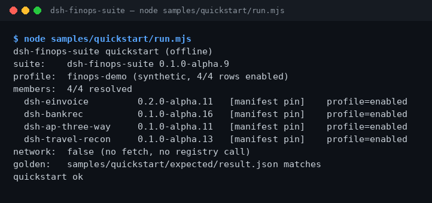

<div align="center">

# dsh-finops-suite

> **官方仓库。** 本包唯一官方仓库，由 PerryLink 维护；其他账号下的同名仓库与本项目无关。Apache-2.0。

[](https://www.npmjs.com/package/dsh-finops-suite)
[](https://github.com/PerryLink/dsh-finops-suite/actions)
[](LICENSE)
[](https://github.com/topics/dsh-plugin)
[](https://perrylink.github.io/dsh-plugins/)
[](https://gitee.com/perrylink/dsh-plugins)
[](https://dshfind.com/plugins/PerryLink/dsh-finops-suite?ref=badge)
[](https://dsh.market/)
[](#)
[](https://www.npmjs.com/package/dsh-finops-suite)

**一键安装财务运营套件：电子发票、银行对账、三单匹配与差旅对账。**

> **状态：alpha / 公开合成 / partial / not counted / 非 GA。** 不含客户证据、客户数据，也不作生产可用声明。

[English](README.md) · [简体中文](README-zh.md) · [Español](README-es.md) · [Português](README-pt.md) · [हिन्दी](README-hi.md)

```sh
dsh plugin --profile <profile> add dsh-finops-suite
```

</div>

> ⭐ 如果它帮到了你，点个 star 会让下一个人更容易找到它；没有任何功能被 star 解锁。


*工作流：本地输入 → 插件 → 本地输出；不需要调用模型。*

## 一句话

一次装齐财务四件套，并核对四个成员包的版本是否可解析。

## 适合 / 不适合

- **适合**：要在一个 DSH profile 里同时装电子发票、银行对账、三单匹配、差旅对账；需要把四个成员锁在同一组版本；装完先确认成员行一个不少。
- **不适合**：只想装其中一件（直接装对应成员包更轻）；想让 suite 自己处理发票或流水（suite 没有工具面，处理由成员包完成）；需要 OCR、联网抓流水或对接 ERP。

## 输入

- 安装动作本身不读业务单据。
- 自带样例读取 `samples/quickstart/input/profile.json`（合成 profile dump，< 1 KB）、本包 `package.json` 与 `cordis.patch.yml`；不读其他目录、不读客户数据。
- 成员包各自的输入（发票、银行流水、三单、差旅单）见成员仓库 README；本 suite 不改变它们的输入输出。

## 输出

- 终端给出成员清单、固定版本、解析来源；退出码 `0` 表示 4/4 可解析。
- `node samples/quickstart/run.mjs --json` 输出金标 JSON，文件在 `samples/quickstart/expected/result.json`。
- 不写任何文件、不调用模型、不联网、不上传；不改动原文件。

## 示例

把这句话粘进 DSH：

> 帮我装好财务运营四件套（电子发票、银行对账、三单匹配、差旅对账），确认四个成员包都能解析，并列出各自版本。

装好后在包目录跑自带样例（离线，不装依赖也能跑）：

```sh
node samples/quickstart/run.mjs
```

真实输出：

```text
dsh-finops-suite quickstart (offline)
suite:    dsh-finops-suite 0.1.0-alpha.10
profile:  finops-demo (synthetic, 4/4 rows enabled)
members:  4/4 resolved
  dsh-einvoice         0.1.0-alpha.10   [manifest pin]    profile=enabled
  dsh-bankrec          0.1.0-alpha.10   [manifest pin]    profile=enabled
  dsh-ap-three-way     0.1.0-alpha.10   [manifest pin]    profile=enabled
  dsh-travel-recon     0.1.0-alpha.10   [manifest pin]    profile=enabled
network:  false (no fetch, no registry call)
golden:   samples/quickstart/expected/result.json matches
quickstart ok
```



截图就是上面这条命令的真实输出；金标与截图记录见 `screenshots.json`。

## 权限

读：`samples/quickstart/input/profile.json`、`cordis.patch.yml`、`package.json`；不读其他目录
写：无（R0，只打印到终端；不写 `$DSH_HOME`、不改原文件）
联网：否
外部系统：无

## FAQ

1. **装不上或装完少一个成员？** 先跑 `node samples/quickstart/run.mjs`。如果两处成员列表不一致，会报 `E_SUITE_PATCH_MISMATCH`；按 [TROUBLESHOOTING.md](TROUBLESHOOTING.md) 对齐后重装。
2. **结果不对，版本和套件声明的不一样？** 套件固定成员版本；单独升级成员会报 `E_SUITE_VERSION_MISMATCH`。删掉该 profile 下的 `node_modules` 后重装 suite。
3. **能直接处理我的发票 / 流水吗？** suite 本身不处理单据，只负责一次装齐成员。发票、银行对账、三单匹配、差旅对账各自用成员包的工具；自带样例只用合成 profile，不读真实单据。
4. **卸载 suite 会把成员也删掉吗？** 不会。卸载只移除 suite 行，成员包保留；不需要时再逐个卸载。

## 版本

当前版本：`0.1.0-alpha.10`（与 `package.json` 一致）。

本地验证（2026-11-02）：

```sh
node --test test/suite.test.mjs            # 8 项通过，0 失败
node samples/quickstart/run.mjs --check    # golden matches
```

## 安装

安装并验证：

```sh
dsh plugin --profile <profile> add dsh-finops-suite
dsh --profile <profile> --dump-config | grep dsh-finops-suite
```

卸载：

```sh
dsh plugin --profile <profile> remove dsh-finops-suite
```

卸载 suite 只移除 suite 行；成员包仍保持安装。如需移除，请逐个卸载。见 [SUITE.md](SUITE.md)。


### 安装通道

推荐 npm；其他通道用于固定版本或离线。

- **npm（推荐）:** `dsh plugin --profile <profile> add dsh-finops-suite`
- **git 通道:** `dsh plugin --profile <profile> add github:PerryLink/dsh-finops-suite`
- **tarball:** `pnpm pack` then `dsh plugin --profile <profile> add ./dsh-finops-suite-<version>.tgz`
- **1024 商店:** `npm i -g dsh1024` then `dsh1024 plugin --profile <profile> add dsh-finops-suite`

## 它做什么

一键安装财务运营套件：电子发票、银行对账、三单匹配与差旅对账。 在 DeepSeek Harness 本地运行；下表就是实际工具面，示例使用真实命令面。

输入和输出都留在本地，不上传。

## 成员

suite 只负责安装这些成员，本身没有工具面；版本由 `dependencies` 固定。

| 成员 | 版本 |
|---|---:|
| `dsh-einvoice` | `0.1.0-alpha.10` |
| `dsh-bankrec` | `0.1.0-alpha.10` |
| `dsh-ap-three-way` | `0.1.0-alpha.10` |
| `dsh-travel-recon` | `0.1.0-alpha.10` |

## 安装后自检

装完先跑自带样例，确认四个成员都能解析：

```sh
node samples/quickstart/run.mjs
```

成员包各自的工具面见上表链接的成员仓库；suite 本身不提供工具。

## 边界

- 仅公开/合成样例；不含客户数据或客户证据。
- alpha/partial、not counted，不作 GA 或生产可用声明。
- 除非工具明确说明，否则不调用模型、不联网。
- 每个工具的精确边界见工具表与 `ACCEPTANCE.csv`。

## 公开样例

公开/合成 fixture 在 `fixtures/`；`ACCEPTANCE.csv` 记录公开检查，全部 `counted=false`。

## 开发

```sh
pnpm install --frozen-lockfile
pnpm build && pnpm lint && pnpm typecheck && pnpm test
```

## 兼容性

| 维度 | 状态 |
|---|---|
| Harness | `dsh >=0.2.1-rc.3 <0.3.0` |
| Node | `>=24.9.0 <25` |
| Platforms | All; local files only |
| 数据 | No network, no model call, no upload |

## 权限与数据

- 本地运行；不联网、不调用模型、不上传。
- 只使用公开/合成 fixture；不含客户数据或客户证据。
- alpha/partial；not counted，不作 GA 或生产可用声明。

## 相关项目

兄弟包与家族索引： [dsh-einvoice](https://github.com/PerryLink/dsh-einvoice) · [dsh-bankrec](https://github.com/PerryLink/dsh-bankrec) · [dsh-ap-three-way](https://github.com/PerryLink/dsh-ap-three-way) · [dsh-travel-recon](https://github.com/PerryLink/dsh-travel-recon)

- [领域索引](https://perrylink.github.io/dsh-plugins/)
- [Checker 家族](https://perrylink.github.io/zh/checkers/)
- [主线家族](https://github.com/PerryLink/dsh-kit)
- [Scenario article](https://perrylink.github.io/dsh-plugins/articles/finops-suite.html)

## 家族

<details>
<summary>DSH 领域插件家族（15 个包 + 2 个 suite）</summary>

| Package | npm |
|---|---|
| **[dsh-einvoice](https://github.com/PerryLink/dsh-einvoice)** | [npm](https://www.npmjs.com/package/dsh-einvoice) |
| **[dsh-docx-redline](https://github.com/PerryLink/dsh-docx-redline)** | [npm](https://www.npmjs.com/package/dsh-docx-redline) |
| **[dsh-policy-ledger](https://github.com/PerryLink/dsh-policy-ledger)** | [npm](https://www.npmjs.com/package/dsh-policy-ledger) |
| **[dsh-ghg](https://github.com/PerryLink/dsh-ghg)** | [npm](https://www.npmjs.com/package/dsh-ghg) |
| **[dsh-bankrec](https://github.com/PerryLink/dsh-bankrec)** | [npm](https://www.npmjs.com/package/dsh-bankrec) |
| **[dsh-ap-three-way](https://github.com/PerryLink/dsh-ap-three-way)** | [npm](https://www.npmjs.com/package/dsh-ap-three-way) |
| **[dsh-ifc-qto](https://github.com/PerryLink/dsh-ifc-qto)** | [npm](https://www.npmjs.com/package/dsh-ifc-qto) |
| **[dsh-qms-capa](https://github.com/PerryLink/dsh-qms-capa)** | [npm](https://www.npmjs.com/package/dsh-qms-capa) |
| **[dsh-legal-intake](https://github.com/PerryLink/dsh-legal-intake)** | [npm](https://www.npmjs.com/package/dsh-legal-intake) |
| **[dsh-legal-clause](https://github.com/PerryLink/dsh-legal-clause)** | [npm](https://www.npmjs.com/package/dsh-legal-clause) |
| **[dsh-freight-audit](https://github.com/PerryLink/dsh-freight-audit)** | [npm](https://www.npmjs.com/package/dsh-freight-audit) |
| **[dsh-hs-candidate](https://github.com/PerryLink/dsh-hs-candidate)** | [npm](https://www.npmjs.com/package/dsh-hs-candidate) |
| **[dsh-travel-recon](https://github.com/PerryLink/dsh-travel-recon)** | [npm](https://www.npmjs.com/package/dsh-travel-recon) |
| **[dsh-pim-lint](https://github.com/PerryLink/dsh-pim-lint)** | [npm](https://www.npmjs.com/package/dsh-pim-lint) |
| **[dsh-eval-pack](https://github.com/PerryLink/dsh-eval-pack)** | [npm](https://www.npmjs.com/package/dsh-eval-pack) |
| **[dsh-finops-suite](https://github.com/PerryLink/dsh-finops-suite)** | [npm](https://www.npmjs.com/package/dsh-finops-suite) |
| **[dsh-contract-suite](https://github.com/PerryLink/dsh-contract-suite)** | [npm](https://www.npmjs.com/package/dsh-contract-suite) |

</details>


<details>
<summary>主线家族 — 92 个当前安装 spec</summary>

| Package | npm |
|---|---|
| **[dsh-aqua-input-check](https://github.com/PerryLink/dsh-aqua-input-check)** | [npm](https://www.npmjs.com/package/dsh-aqua-input-check) |
| **[dsh-archive-check](https://github.com/PerryLink/dsh-archive-check)** | [npm](https://www.npmjs.com/package/dsh-archive-check) |
| **[dsh-bid-ca-precheck](https://github.com/PerryLink/dsh-bid-ca-precheck)** | [npm](https://www.npmjs.com/package/dsh-bid-ca-precheck) |
| **[dsh-bid-qual-check](https://github.com/PerryLink/dsh-bid-qual-check)** | [npm](https://www.npmjs.com/package/dsh-bid-qual-check) |
| **[dsh-contract-stance](https://github.com/PerryLink/dsh-contract-stance)** | [npm](https://www.npmjs.com/package/dsh-contract-stance) |
| **[dsh-customs-doc-check](https://github.com/PerryLink/dsh-customs-doc-check)** | [npm](https://www.npmjs.com/package/dsh-customs-doc-check) |
| **[dsh-demurrage-ledger](https://github.com/PerryLink/dsh-demurrage-ledger)** | [npm](https://www.npmjs.com/package/dsh-demurrage-ledger) |
| **[dsh-drill-script-check](https://github.com/PerryLink/dsh-drill-script-check)** | [npm](https://www.npmjs.com/package/dsh-drill-script-check) |
| **[dsh-eia-guide-check](https://github.com/PerryLink/dsh-eia-guide-check)** | [npm](https://www.npmjs.com/package/dsh-eia-guide-check) |
| **[dsh-emergency-plan](https://github.com/PerryLink/dsh-emergency-plan)** | [npm](https://www.npmjs.com/package/dsh-emergency-plan) |
| **[dsh-essay-rubric-check](https://github.com/PerryLink/dsh-essay-rubric-check)** | [npm](https://www.npmjs.com/package/dsh-essay-rubric-check) |
| **[dsh-evidence-check](https://github.com/PerryLink/dsh-evidence-check)** | [npm](https://www.npmjs.com/package/dsh-evidence-check) |
| **[dsh-export-ctl-check](https://github.com/PerryLink/dsh-export-ctl-check)** | [npm](https://www.npmjs.com/package/dsh-export-ctl-check) |
| **[dsh-fmea-table-check](https://github.com/PerryLink/dsh-fmea-table-check)** | [npm](https://www.npmjs.com/package/dsh-fmea-table-check) |
| **[dsh-forecast-penalty](https://github.com/PerryLink/dsh-forecast-penalty)** | [npm](https://www.npmjs.com/package/dsh-forecast-penalty) |
| **[dsh-gongwen-flow-check](https://github.com/PerryLink/dsh-gongwen-flow-check)** | [npm](https://www.npmjs.com/package/dsh-gongwen-flow-check) |
| **[dsh-gongwen-word-check](https://github.com/PerryLink/dsh-gongwen-word-check)** | [npm](https://www.npmjs.com/package/dsh-gongwen-word-check) |
| **[dsh-guard-plan-qc](https://github.com/PerryLink/dsh-guard-plan-qc)** | [npm](https://www.npmjs.com/package/dsh-guard-plan-qc) |
| **[dsh-hazchem-check](https://github.com/PerryLink/dsh-hazchem-check)** | [npm](https://www.npmjs.com/package/dsh-hazchem-check) |
| **[dsh-hazplan-check](https://github.com/PerryLink/dsh-hazplan-check)** | [npm](https://www.npmjs.com/package/dsh-hazplan-check) |
| **[dsh-hidden-risk-map](https://github.com/PerryLink/dsh-hidden-risk-map)** | [npm](https://www.npmjs.com/package/dsh-hidden-risk-map) |
| **[dsh-hs-classify](https://github.com/PerryLink/dsh-hs-classify)** | [npm](https://www.npmjs.com/package/dsh-hs-classify) |
| **[dsh-icd-rule-check](https://github.com/PerryLink/dsh-icd-rule-check)** | [npm](https://www.npmjs.com/package/dsh-icd-rule-check) |
| **[dsh-lawcite-adapter](https://github.com/PerryLink/dsh-lawcite-adapter)** | [npm](https://www.npmjs.com/package/dsh-lawcite-adapter) |
| **[dsh-lc-doc-check](https://github.com/PerryLink/dsh-lc-doc-check)** | [npm](https://www.npmjs.com/package/dsh-lc-doc-check) |
| **[dsh-learning-gap-check](https://github.com/PerryLink/dsh-learning-gap-check)** | [npm](https://www.npmjs.com/package/dsh-learning-gap-check) |
| **[dsh-medrec-qc](https://github.com/PerryLink/dsh-medrec-qc)** | [npm](https://www.npmjs.com/package/dsh-medrec-qc) |
| **[dsh-nsfc-form-check](https://github.com/PerryLink/dsh-nsfc-form-check)** | [npm](https://www.npmjs.com/package/dsh-nsfc-form-check) |
| **[dsh-nurse-record-check](https://github.com/PerryLink/dsh-nurse-record-check)** | [npm](https://www.npmjs.com/package/dsh-nurse-record-check) |
| **[dsh-origin-rvc-check](https://github.com/PerryLink/dsh-origin-rvc-check)** | [npm](https://www.npmjs.com/package/dsh-origin-rvc-check) |
| **[dsh-ota-review-check](https://github.com/PerryLink/dsh-ota-review-check)** | [npm](https://www.npmjs.com/package/dsh-ota-review-check) |
| **[dsh-paper-doc-adapter](https://github.com/PerryLink/dsh-paper-doc-adapter)** | [npm](https://www.npmjs.com/package/dsh-paper-doc-adapter) |
| **[dsh-permit-report-check](https://github.com/PerryLink/dsh-permit-report-check)** | [npm](https://www.npmjs.com/package/dsh-permit-report-check) |
| **[dsh-pipeline-check](https://github.com/PerryLink/dsh-pipeline-check)** | [npm](https://www.npmjs.com/package/dsh-pipeline-check) |
| **[dsh-pleading-draft](https://github.com/PerryLink/dsh-pleading-draft)** | [npm](https://www.npmjs.com/package/dsh-pleading-draft) |
| **[dsh-policy-brief-draft](https://github.com/PerryLink/dsh-policy-brief-draft)** | [npm](https://www.npmjs.com/package/dsh-policy-brief-draft) |
| **[dsh-power-loss-split](https://github.com/PerryLink/dsh-power-loss-split)** | [npm](https://www.npmjs.com/package/dsh-power-loss-split) |
| **[dsh-power-ticket-check](https://github.com/PerryLink/dsh-power-ticket-check)** | [npm](https://www.npmjs.com/package/dsh-power-ticket-check) |
| **[dsh-ppap-check](https://github.com/PerryLink/dsh-ppap-check)** | [npm](https://www.npmjs.com/package/dsh-ppap-check) |
| **[dsh-protest-deadline](https://github.com/PerryLink/dsh-protest-deadline)** | [npm](https://www.npmjs.com/package/dsh-protest-deadline) |
| **[dsh-railway-window](https://github.com/PerryLink/dsh-railway-window)** | [npm](https://www.npmjs.com/package/dsh-railway-window) |
| **[dsh-repair-order-qc](https://github.com/PerryLink/dsh-repair-order-qc)** | [npm](https://www.npmjs.com/package/dsh-repair-order-qc) |
| **[dsh-review-reply-check](https://github.com/PerryLink/dsh-review-reply-check)** | [npm](https://www.npmjs.com/package/dsh-review-reply-check) |
| **[dsh-rulefile-check](https://github.com/PerryLink/dsh-rulefile-check)** | [npm](https://www.npmjs.com/package/dsh-rulefile-check) |
| **[dsh-safety-brief-check](https://github.com/PerryLink/dsh-safety-brief-check)** | [npm](https://www.npmjs.com/package/dsh-safety-brief-check) |
| **[dsh-site-log-check](https://github.com/PerryLink/dsh-site-log-check)** | [npm](https://www.npmjs.com/package/dsh-site-log-check) |
| **[dsh-soe-decision-check](https://github.com/PerryLink/dsh-soe-decision-check)** | [npm](https://www.npmjs.com/package/dsh-soe-decision-check) |
| **[dsh-soilwater-check](https://github.com/PerryLink/dsh-soilwater-check)** | [npm](https://www.npmjs.com/package/dsh-soilwater-check) |
| **[dsh-sop-sync-check](https://github.com/PerryLink/dsh-sop-sync-check)** | [npm](https://www.npmjs.com/package/dsh-sop-sync-check) |
| **[dsh-spc-gbt-adapter](https://github.com/PerryLink/dsh-spc-gbt-adapter)** | [npm](https://www.npmjs.com/package/dsh-spc-gbt-adapter) |
| **[dsh-tender-extract](https://github.com/PerryLink/dsh-tender-extract)** | [npm](https://www.npmjs.com/package/dsh-tender-extract) |
| **[dsh-tender-matrix](https://github.com/PerryLink/dsh-tender-matrix)** | [npm](https://www.npmjs.com/package/dsh-tender-matrix) |
| **[dsh-warranty-calc](https://github.com/PerryLink/dsh-warranty-calc)** | [npm](https://www.npmjs.com/package/dsh-warranty-calc) |
| **[dsh-auto-review](https://github.com/PerryLink/dsh-auto-review)** | [npm](https://www.npmjs.com/package/dsh-auto-review) |
| **[dsh-autotier](https://github.com/PerryLink/dsh-autotier)** | [npm](https://www.npmjs.com/package/dsh-autotier) |
| **[dsh-budget](https://github.com/PerryLink/dsh-budget)** | [npm](https://www.npmjs.com/package/dsh-budget) |
| **[dsh-cert-mcp](https://github.com/PerryLink/dsh-cert-mcp)** | [npm](https://www.npmjs.com/package/dsh-cert-mcp) |
| **[dsh-checkpoint-rewind](https://github.com/PerryLink/dsh-checkpoint-rewind)** | [npm](https://www.npmjs.com/package/dsh-checkpoint-rewind) |
| **[dsh-claude-move](https://github.com/PerryLink/dsh-claude-move)** | [npm](https://www.npmjs.com/package/dsh-claude-move) |
| **[dsh-click](https://github.com/PerryLink/dsh-click)** | [npm](https://www.npmjs.com/package/dsh-click) |
| **[dsh-composer-history](https://github.com/PerryLink/dsh-composer-history)** | [npm](https://www.npmjs.com/package/dsh-composer-history) |
| **[dsh-data-quality](https://github.com/PerryLink/dsh-data-quality)** | [npm](https://www.npmjs.com/package/dsh-data-quality) |
| **[dsh-defend](https://github.com/PerryLink/dsh-defend)** | [npm](https://www.npmjs.com/package/dsh-defend) |
| **[dsh-doublecheck](https://github.com/PerryLink/dsh-doublecheck)** | [npm](https://www.npmjs.com/package/dsh-doublecheck) |
| **[dsh-draw](https://github.com/PerryLink/dsh-draw)** | [npm](https://www.npmjs.com/package/dsh-draw) |
| **[dsh-fast](https://github.com/PerryLink/dsh-fast)** | [npm](https://www.npmjs.com/package/dsh-fast) |
| **[dsh-fund-research](https://github.com/PerryLink/dsh-fund-research)** | [npm](https://www.npmjs.com/package/dsh-fund-research) |
| **[dsh-industry-research](https://github.com/PerryLink/dsh-industry-research)** | [npm](https://www.npmjs.com/package/dsh-industry-research) |
| **[dsh-laya](https://github.com/PerryLink/dsh-laya)** | [npm](https://www.npmjs.com/package/dsh-laya) |
| **[dsh-library](https://github.com/PerryLink/dsh-library)** | [npm](https://www.npmjs.com/package/dsh-library) |
| **[dsh-local-ai](https://github.com/PerryLink/dsh-local-ai)** | [npm](https://www.npmjs.com/package/dsh-local-ai) |
| **[dsh-lsp-actions](https://github.com/PerryLink/dsh-lsp-actions)** | [npm](https://www.npmjs.com/package/dsh-lsp-actions) |
| **[dsh-mask](https://github.com/PerryLink/dsh-mask)** | [npm](https://www.npmjs.com/package/dsh-mask) |
| **[dsh-mcp-panel](https://github.com/PerryLink/dsh-mcp-panel)** | [npm](https://www.npmjs.com/package/dsh-mcp-panel) |
| **[dsh-memento](https://github.com/PerryLink/dsh-memento)** | [npm](https://www.npmjs.com/package/dsh-memento) |
| **[dsh-observe](https://github.com/PerryLink/dsh-observe)** | [npm](https://www.npmjs.com/package/dsh-observe) |
| **[dsh-output-styles](https://github.com/PerryLink/dsh-output-styles)** | [npm](https://www.npmjs.com/package/dsh-output-styles) |
| **[dsh-permission-rules](https://github.com/PerryLink/dsh-permission-rules)** | [npm](https://www.npmjs.com/package/dsh-permission-rules) |
| **[dsh-plugin-guide](https://github.com/PerryLink/dsh-plugin-guide)** | [npm](https://www.npmjs.com/package/dsh-plugin-guide) |
| **[dsh-plugin-upgrade](https://github.com/PerryLink/dsh-plugin-upgrade)** | [npm](https://www.npmjs.com/package/dsh-plugin-upgrade) |
| **[dsh-reach](https://github.com/PerryLink/dsh-reach)** | [npm](https://www.npmjs.com/package/dsh-reach) |
| **[dsh-research-report](https://github.com/PerryLink/dsh-research-report)** | [npm](https://www.npmjs.com/package/dsh-research-report) |
| **[dsh-score](https://github.com/PerryLink/dsh-score)** | [npm](https://www.npmjs.com/package/dsh-score) |
| **[dsh-session-sync](https://github.com/PerryLink/dsh-session-sync)** | [npm](https://www.npmjs.com/package/dsh-session-sync) |
| **[dsh-talk](https://github.com/PerryLink/dsh-talk)** | [npm](https://www.npmjs.com/package/dsh-talk) |
| **[dsh-test-drive](https://github.com/PerryLink/dsh-test-drive)** | [npm](https://www.npmjs.com/package/dsh-test-drive) |
| **[dsh-translate](https://github.com/PerryLink/dsh-translate)** | [npm](https://www.npmjs.com/package/dsh-translate) |
| **[](https://github.com/PerryLink/)** | [npm](https://www.npmjs.com/package/) |
| **[](https://github.com/PerryLink/)** | [npm](https://www.npmjs.com/package/) |
| **[](https://github.com/PerryLink/)** | [npm](https://www.npmjs.com/package/) |
| **[](https://github.com/PerryLink/)** | [npm](https://www.npmjs.com/package/) |
| **[](https://github.com/PerryLink/)** | [npm](https://www.npmjs.com/package/) |

</details>

## 许可证

Apache-2.0. See `LICENSE`, `NOTICE`, `THIRD-PARTY-NOTICES`.
