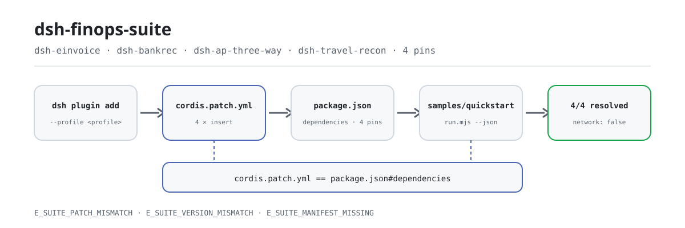
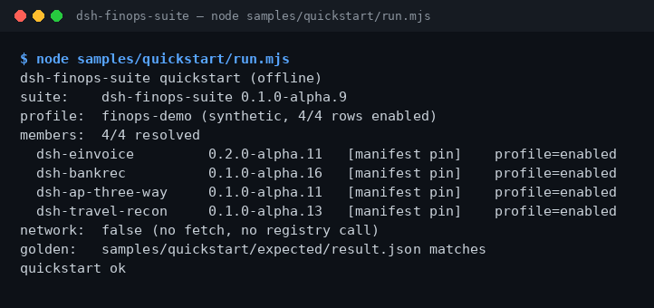

<div align="center">

<picture>
  <source media="(prefers-color-scheme: dark)" srcset="docs/assets/dsh-finops-suite-flow-dark.svg">
  
</picture>

# dsh-finops-suite

**Instale os quatro pacotes de finanças e operações com um único comando e confirme que cada versão de membro resolve.**

Suíte somente de instalação para o DeepSeek Harness: fatura eletrônica (`dsh-einvoice`), conciliação bancária (`dsh-bankrec`), three-way match (`dsh-ap-three-way`) e conciliação de viagens (`dsh-travel-recon`), fixados em um único conjunto de versões exatas e instalados juntos. A suíte não tem superfície de ferramentas própria: não lê documentos, não faz chamadas de rede, não invoca modelos e mantém entrada e saída no local.

[Instalação](#instalação-em-três-passos) · [Configuração](#configuração) · [FAQ](#faq) · [简体中文](README.md) · [English](README.en.md) · [Español](README.es.md) · [Português](README.pt.md) · [हिन्दी](README.hi.md)

[](LICENSE)
[](#compatibilidade)
[](https://www.npmjs.com/package/dsh-finops-suite)
[](https://github.com/PerryLink/dsh-finops-suite/actions/workflows/ci.yml)
[](#compatibilidade)

[](https://github.com/PerryLink/dsh-finops-suite/stargazers)
[](https://www.npmjs.com/package/dsh-finops-suite)
[](https://dshfind.com/plugins/PerryLink/dsh-finops-suite?ref=badge)
[](https://dsh.market/)
[](https://gitee.com/perrylink/dsh-plugins)

```sh
dsh plugin --profile <profile> add dsh-finops-suite
```

</div>

<sub>Suíte da comunidade, sem afiliação com a DeepSeek. Repositório canônico: <https://github.com/PerryLink/dsh-finops-suite> (Apache-2.0).</sub>

## O que é

`dsh-finops-suite` instala de uma vez os quatro pacotes de finanças e operações: fatura eletrônica (`dsh-einvoice`), conciliação bancária (`dsh-bankrec`), three-way match (`dsh-ap-three-way`) e conciliação de viagens (`dsh-travel-recon`). `package.json#dependencies` fixa os quatro membros em versões exatas e `cordis.patch.yml` insere as quatro linhas de membros no perfil. Depois de instalar, execute o exemplo offline incluído: o terminal mostra cada membro, sua versão fixada e de onde ela resolveu; 4/4 resolved significa que o conjunto está completo. A suíte é um **bundle somente de instalação**: sem superfície de ferramentas, sem chaves de configuração, sem ler documentos, sem chamada de modelo, sem rede e sem gravar arquivos. As faturas, extratos, linhas de three-way e despesas de viagem reais são tratados pelas ferramentas dos quatro membros.

## Para que serve / para que não serve

- **Serve para:** instalar fatura eletrônica, conciliação bancária, three-way match e conciliação de viagens em um mesmo perfil do DSH; manter os quatro membros em um único conjunto de versões fixadas; confirmar logo após a instalação que nenhuma linha de membro falta.
- **Não serve para:** instalar apenas um pacote (instale esse membro diretamente); esperar que a suíte processe faturas ou extratos (ela não tem superfície de ferramentas — os membros têm); OCR, conexão bancária ao vivo ou integração com ERP.

## Entrada e saída

**Entrada**

- A instalação em si não lê documentos de negócio.
- O exemplo incluído lê apenas `samples/quickstart/input/profile.json` (dump de perfil sintético, < 1 KB), o `package.json` deste pacote e `cordis.patch.yml`. Não lê outro diretório nem dados de clientes.
- A entrada de cada membro (faturas, extratos bancários, linhas de three-way, despesas de viagem) está documentada no README desse membro; a suíte não a altera.

**Saída**

- O terminal mostra a lista de membros, as versões fixadas e de onde cada versão resolveu; o código de saída `0` significa 4/4 resolvidos.
- `node samples/quickstart/run.mjs --json` imprime o JSON dourado guardado em `samples/quickstart/expected/result.json`; `--check` compara campo a campo.
- Nenhum arquivo é gravado, nenhum modelo é chamado, nenhuma rede é usada, nada é enviado e os arquivos originais não são tocados.

## Instalação em três passos

1. **Instalar** (escolha um canal):

   ```sh
   # canal npm (recomendado, versões publicadas)
   dsh plugin --profile <profile> add dsh-finops-suite
   # canal git (main mais recente)
   dsh plugin --profile <profile> add github:PerryLink/dsh-finops-suite
   # canal tarball: pnpm pack neste repositório e depois
   dsh plugin --profile <profile> add ./dsh-finops-suite-<version>.tgz
   # canal loja 1024
   npm i -g dsh1024 && dsh1024 plugin --profile <profile> add dsh-finops-suite
   ```

   Sem etapa de build: ESM puro; `src/` e `samples/` são o conteúdo publicado.

2. **Montar** (já acontece por padrão): o bundle aplica `cordis.patch.yml` e insere as quatro linhas de membros no perfil:

   ```yaml
   - insert:
       - id: dsh-einvoice
         name: dsh-einvoice
       - id: dsh-bankrec
         name: dsh-bankrec
       - id: dsh-ap-three-way
         name: dsh-ap-three-way
       - id: dsh-travel-recon
         name: dsh-travel-recon
   ```

   A suíte não tem chaves de configuração; a configuração de cada membro fica no README dele.

3. **Verificar que funcionou**:

   ```sh
   dsh --profile <profile> --dump-config | grep dsh-finops-suite
   node samples/quickstart/run.mjs
   ```

   Saída real (executada em 2026-11-05, trecho de resolução de membros):

   ```text
   dsh-finops-suite quickstart (offline)
   suite:    dsh-finops-suite 0.1.0-alpha.11
   profile:  finops-demo (synthetic, 4/4 rows enabled)
   members:  4/4 resolved
     dsh-einvoice         0.2.0-alpha.11   [manifest pin]    profile=enabled
     dsh-bankrec          0.1.0-alpha.16   [manifest pin]    profile=enabled
     dsh-ap-three-way     0.1.0-alpha.11   [manifest pin]    profile=enabled
     dsh-travel-recon     0.1.0-alpha.13   [manifest pin]    profile=enabled
   network:  false (no fetch, no registry call)
   ```

   O arquivo dourado ainda registra `0.1.0-alpha.9`, então `--check` hoje relata divergência com o dourado no final; a resolução de membros continua 4/4. Veja «Limitações conhecidas».

**Desinstalar**: `dsh plugin --profile <profile> remove dsh-finops-suite` (ou remova a linha do patch do perfil). Remover a suíte apaga apenas a linha dela; os pacotes membros continuam instalados. Remova-os individualmente se não precisar mais. Veja [SUITE.md](SUITE.md).

## Capacidades principais

- **Um comando instala o conjunto** — um único `dsh plugin add` instala os quatro membros, sem precisar lembrar quatro nomes e quatro versões.
- **Versões travadas em conjunto** — as versões dos membros são fixadas em `package.json#dependencies`; um membro instalado em outra versão dispara `E_SUITE_VERSION_MISMATCH` em vez de misturar versões em silêncio. Atualize a suíte, não um membro isolado.
- **Conciliação de linhas** — `cordis.patch.yml` e `dependencies` são conferidos nos dois sentidos: linha faltando, linha sobrando, id duplicado ou `id`/`name` divergentes geram `E_SUITE_PATCH_MISMATCH`; manifesto ausente ou JSON inválido gera `E_SUITE_MANIFEST_MISSING`.
- **Autoverificação offline** — `samples/quickstart/run.mjs` lê três arquivos e mostra membros, versões fixadas e origem da resolução; `--json` entrega saída legível por máquina e `--check` compara com o arquivo dourado. Zero rede, zero gravações.
- **Sem superfície de ferramentas** — não registra ferramentas, comandos, slots, rotas HTTP nem chaves de serviço; apenas insere quatro linhas de membros. Os membros seguem independentes e podem ser instalados ou removidos isoladamente.
- **Evidência reproduzível** — `ACCEPTANCE.csv` registra as linhas públicas de aceitação (`counted` indica se contam), `screenshots.json` registra o comando, a hora e o SHA-256 da captura, e `node scripts/acceptance.mjs` reconstrói as linhas.

## Membros e versões

A suíte só instala estes membros e não tem superfície de ferramentas própria. As versões são fixadas em `dependencies`.

| Membro | Versão fixada |
|---|---:|
| `dsh-einvoice` | `0.2.0-alpha.11` |
| `dsh-bankrec` | `0.1.0-alpha.16` |
| `dsh-ap-three-way` | `0.1.0-alpha.11` |
| `dsh-travel-recon` | `0.1.0-alpha.13` |

Versão atual da suíte: `0.1.0-alpha.11` (igual a `package.json`).

## Exemplo

Cole isto no DSH:

> Instale os quatro pacotes de finanças e operações (fatura eletrônica, conciliação bancária, three-way match e conciliação de viagens), confirme que os quatro membros resolvem e liste cada versão.

Depois execute o exemplo incluído no diretório do pacote (offline, sem instalar dependências):

```sh
node samples/quickstart/run.mjs
```

A saída real está no passo 3 de «Instalação em três passos». A captura é a saída real de terminal do mesmo comando, obtida em 2026-11-02 (na época a versão da suíte era `0.1.0-alpha.9`; as versões dos membros são as mesmas de agora):



Os metadados da captura (comando, hora, SHA-256 da saída) estão em `screenshots.json`.

## Configuração

A suíte é um bundle somente de instalação: **sem esquema Config e sem chaves em tempo de execução**. Só a superfície de montagem e o destino de instalação são ajustáveis:

| Ajustável | Onde | Valor atual | Observações |
|---|---|---|---|
| Conjunto de membros | `cordis.patch.yml` | `dsh-einvoice`, `dsh-bankrec`, `dsh-ap-three-way`, `dsh-travel-recon` | Uma linha `id` + `name` por membro; precisa coincidir exatamente com `dependencies` |
| Versões dos membros | `package.json#dependencies` | `0.2.0-alpha.11`, `0.1.0-alpha.16`, `0.1.0-alpha.11`, `0.1.0-alpha.13` | Versões exatas; atualizar um membro dispara `E_SUITE_VERSION_MISMATCH` |
| Destino da instalação | `dsh plugin --profile <profile>` | à sua escolha | A suíte instala apenas no perfil indicado |
| Metadados do demo | `package.json#dsh.demo` | `sample` / `prompt` / `expect` / `screenshot` | Declara o exemplo offline, o prompt e os caminhos de evidência |

A configuração de cada membro (faturas, extratos, linhas de three-way, despesas de viagem) fica no README do membro; a suíte não lê, não reescreve e não sobrescreve linhas de configuração dos membros.

<details>
<summary>Arquivo de montagem completo (cordis.patch.yml)</summary>

```yaml
- insert:
    - id: dsh-einvoice
      name: dsh-einvoice
    - id: dsh-bankrec
      name: dsh-bankrec
    - id: dsh-ap-three-way
      name: dsh-ap-three-way
    - id: dsh-travel-recon
      name: dsh-travel-recon
```

</details>

<details>
<summary>Canais de instalação comparados</summary>

| Canal | Comando | Quando usar |
|---|---|---|
| npm (recomendado) | `dsh plugin --profile <profile> add dsh-finops-suite` | Instalação normal a partir de uma versão publicada |
| git | `dsh plugin --profile <profile> add github:PerryLink/dsh-finops-suite` | Acompanhar o main mais recente |
| tarball | `pnpm pack` e depois `dsh plugin --profile <profile> add ./dsh-finops-suite-<version>.tgz` | Offline ou artefato fixado |
| loja 1024 | `npm i -g dsh1024` e depois `dsh1024 plugin --profile <profile> add dsh-finops-suite` | Instalar pelo canal 1024 |

</details>

## FAQ

<details>
<summary>A instalação falha ou falta um membro depois. O que faço?</summary>

Execute primeiro `node samples/quickstart/run.mjs`. Se as duas listas de membros divergirem, é lançado `E_SUITE_PATCH_MISMATCH`; alinhe `cordis.patch.yml` com `dependencies` como descrito em [TROUBLESHOOTING.md](TROUBLESHOOTING.md) e reinstale. Manifesto ausente ou tarball incompleto lança `E_SUITE_MANIFEST_MISSING`; rode de novo na raiz do pacote ou reinstale.

</details>

<details>
<summary>A versão não bate com a declaração da suíte. Por quê?</summary>

A suíte fixa versões exatas e promete um conjunto fixo. Atualizar um membro isoladamente, ou deixar uma versão antiga em `node_modules`, lança `E_SUITE_VERSION_MISMATCH`. Apague `node_modules` nesse perfil e reinstale a suíte; se você realmente precisa de um membro mais novo, espere uma suíte que o fixe — não atualize só o membro.

</details>

<details>
<summary>A suíte pode processar minhas faturas ou extratos?</summary>

Não. A suíte apenas instala membros e não tem superfície de ferramentas própria; fatura eletrônica, conciliação bancária, three-way match e conciliação de viagens usam as ferramentas dos pacotes membros. O exemplo incluído usa um perfil sintético, não lê documentos reais e não produz resultados de negócio.

</details>

<details>
<summary>Desinstalar a suíte remove os membros?</summary>

Não. Remover a suíte apaga apenas a linha dela; os pacotes membros continuam instalados até você removê-los individualmente. Os membros são linhas Cordis independentes e também podem ser instalados sem a suíte.

</details>

<details>
<summary>Onde os dados ficam? Vai à rede ou envia algo?</summary>

A instalação não lê documentos de negócio; o exemplo incluído lê apenas três arquivos: `samples/quickstart/input/profile.json`, `cordis.patch.yml` e `package.json`. Não grava arquivos, não usa rede, não envia nada e não chama modelos. A única peça com rede é `scripts/check.mjs`, do lado de desenvolvimento (consulta o registro para confirmar que as versões dos membros existem); ela não roda na instalação nem em tempo de execução.

</details>

## Permissões e dados

- Leitura: `samples/quickstart/input/profile.json`, `cordis.patch.yml`, `package.json`; nenhum outro diretório
- Gravação: nenhuma (R0 — apenas saída de terminal; sem gravações em `$DSH_HOME`, arquivos originais intactos)
- Rede: não
- Sistemas externos: nenhum
- O repositório contém apenas fixtures públicos/sintéticos (`samples/quickstart/`); `ACCEPTANCE.csv` registra as verificações públicas e a coluna `counted` indica se contam (hoje só a linha do dourado do quickstart é `true`).
- Apenas fixtures públicos/sintéticos; sem dados de clientes e sem evidência de clientes.
- Alpha/partial; not counted, sem declaração de GA ou de prontidão para produção.

## Limites de segurança

- **Só instala; não processa conteúdo.** A suíte não tem superfície de ferramentas nem comandos, e não registra slots ou rotas HTTP; faturas, extratos, linhas de three-way e despesas de viagem permanecem nos pacotes membros e no seu ambiente local.
- **Exemplos públicos/sintéticos.** O repositório contém apenas fixtures públicos ou sintéticos; sem dados de clientes, documentos de clientes ou evidência de clientes, e sem declaração de prontidão para produção.
- **Falha fechada.** Manifesto ausente, divergência entre patch e dependências ou desvio de versão falham com um código `E_` explícito na carga/autoverificação; nunca um downgrade silencioso ou uma instalação misturada.
- **Nunca reescreve a configuração dos membros.** O patch do bundle apenas insere suas quatro linhas; não sobrescreve o `config` de linhas internas ou de membros.
- **Privilégio mínimo.** A instalação não grava `$DSH_HOME` nem toca arquivos-fonte; os limites de permissão e dados de cada ferramenta membro estão no repositório dela e no `ACCEPTANCE`.

## Limitações conhecidas

- **Somente instalação.** A suíte não tem superfície de ferramentas própria; não processa faturas, extratos, linhas de three-way nem despesas de viagem, e não oferece OCR, conexão bancária direta ou integração com ERP. Essas capacidades (quando existem) pertencem aos membros.
- **Alpha / partial / not counted.** Sem declaração de GA ou de prontidão para produção; as linhas públicas de aceitação com `counted=false` não contam como aceitação formal.
- **As versões são decididas pela suíte.** Com os membros fixados, atualizar um deles isoladamente falha; mudar a versão de um membro exige uma nova versão da suíte.
- **O arquivo dourado do exemplo ainda registra `0.1.0-alpha.9`.** `samples/quickstart/expected/result.json` foi escrito para uma suíte anterior, enquanto o pacote atual é `0.1.0-alpha.11`; por isso `node samples/quickstart/run.mjs --check` e os testes que dependem dele relatam divergência com o dourado. `run.mjs --json` continua resolvendo 4/4; regenere o dourado para restaurar a checagem. Isso não afeta a instalação nem a resolução de membros.
- **Sem chaves de configuração.** Os ajustes de cada membro ficam no README dele; a suíte não adiciona interruptores.

## Interoperabilidade com outros plugins DSH

- **Sem serviço, porta ou domínio de armazenamento compartilhados.** A suíte e seus membros não ocupam serviço, porta ou domínio de armazenamento compartilhados; os membros são linhas Cordis independentes.
- **Sem registro de ferramentas/comandos/slots/rotas.** A suíte não registra ferramentas, comandos, slots de cliente nem prefixos `webServer`, então não há colisão de nomes ou disputa de slots.
- **Só inserir, nunca sobrescrever.** O patch do bundle apenas insere linhas de membros; não sobrescreve o `config` de linhas internas ou de membros.
- **Instaláveis separadamente.** Os membros podem ser instalados e removidos sem a suíte; remover a suíte não os leva junto.
- **Independente do canal.** npm, git, tarball e a loja 1024 produzem o mesmo conjunto de membros e as mesmas versões.

## Compatibilidade

| Superfície | Estado |
|---|---|
| Harness | `dsh >=0.2.1-rc.3 <0.3.0` |
| Node | `>=24.9.0 <25` |
| Plataformas | Todas as compatíveis com DSH; apenas arquivos locais |
| Dados | Sem rede, sem chamada de modelo, sem upload |

## Ecossistema e qualidade

- [Índice de domínio](https://perrylink.github.io/dsh-plugins/) (catálogo de pacotes e entradas de instalação)
- [Família Checker](https://perrylink.github.io/zh/checkers/) (visão geral dos plugins de verificação)
- [Família principal](https://github.com/PerryLink/dsh-kit) (specs de instalação e índice da família)
- [Artigo de cenário](https://perrylink.github.io/dsh-plugins/articles/finops-suite.html) (guia da suíte de finanças e operações)
- [Espelho agregado no Gitee](https://gitee.com/perrylink/dsh-plugins) (o GitHub é a fonte canônica)
- [Página do plugin no dshfind](https://dshfind.com/plugins/PerryLink/dsh-finops-suite) (instalações e ranking)
- [DSH Market](https://dsh.market/) (publicado)
- **Canal da loja 1024**: `npm i -g dsh1024` e depois `dsh1024 plugin --profile <profile> add dsh-finops-suite` (conta para o ranking de instalações do [deepseek1024.com](https://deepseek1024.com))
- **Arquivos de evidência**: [`ACCEPTANCE.csv`](ACCEPTANCE.csv) · [`screenshots.json`](screenshots.json) · [`samples/quickstart/expected/result.json`](samples/quickstart/expected/result.json)

## Desenvolvimento

```sh
pnpm quickstart        # node samples/quickstart/run.mjs
pnpm test              # node --test test/suite.test.mjs
pnpm gate              # node scripts/gate.mjs (portão de release offline)
pnpm check             # node scripts/check.mjs (consulta o registro, só CI)
```

Sem etapa de build: o conteúdo publicado é `src/` + `samples/` + `cordis.patch.yml`.

| Caminho | Propósito |
|---|---|
| `src/members.mjs` | Único código em execução: lê `package.json` + `cordis.patch.yml`, valida membros e resolve versões |
| `samples/quickstart/` | Exemplo offline: `input/profile.json`, `expected/result.json`, `run.mjs` |
| `test/suite.test.mjs` | `node --test`: manifesto, exemplo, dourado, ramos de erro |
| `scripts/gate.mjs` | Portão de release: manifesto, exemplo, blocos de documentação, evidência, dourado, testes |
| `scripts/check.mjs` | Smoke de instalação contra o registro (só CI; o único script com rede) |
| `scripts/acceptance.mjs` | Reconstrói `ACCEPTANCE.csv` a partir de verificações locais reais |
| `scripts/gen-readme-assets.py` | Gera as figuras do README (Python + Pillow) |
| `docs/assets/` | Diagrama de fluxo e a captura do quickstart |
| `cordis.patch.yml` | Superfície de montagem dos membros (quatro linhas `insert`) |

As figuras são geradas por [`scripts/gen-readme-assets.py`](scripts/gen-readme-assets.py): `python scripts/gen-readme-assets.py` escreve `docs/assets/dsh-finops-suite-flow-{light,dark}.svg` (vetorial, compartilhado pelos cinco idiomas) e deixa intacto o antigo `dsh-finops-suite-flow.svg`. O script pode ser executado de novo.

README em cinco idiomas: `README.md` é a fonte em chinês; `README.en.md`, `README.es.md`, `README.pt.md` e `README.hi.md` o acompanham.

Versão atual: `0.1.0-alpha.11` (igual a `package.json`). Verificação local histórica (2026-11-02): `node --test test/suite.test.mjs` passou 8 testes e `node samples/quickstart/run.mjs --check` batia com o dourado da época; o desvio atual do dourado está descrito em «Limitações conhecidas».

Topics: `dsh`, `dsh-plugin`, `deepseek-harness`, `deepseek`, `cordis`, `dsh-bundle`, `perrylink`, `suite`, `finance`

## Família e agradecimentos

Este projeto é membro da família de plugins do DeepSeek Harness da [PerryLink](https://github.com/PerryLink) (todos Apache-2.0). Se esta suíte ajudar você, **deixe uma estrela**: ela não desbloqueia nada, mas faz a próxima pessoa encontrá-la mais facilmente.

- [dsh-einvoice](https://github.com/PerryLink/dsh-einvoice) — o membro de fatura eletrônica.
- [dsh-bankrec](https://github.com/PerryLink/dsh-bankrec) — o membro de conciliação bancária.
- [dsh-ap-three-way](https://github.com/PerryLink/dsh-ap-three-way) — o membro de three-way match.
- [dsh-travel-recon](https://github.com/PerryLink/dsh-travel-recon) — o membro de conciliação de viagens.
- [@PerryLink](https://github.com/PerryLink) — criador e mantenedor: contrato da suíte, travamento de versões, quickstart offline, linhas de aceitação e documentação em cinco idiomas.

<details>
<summary>Família de plugins de domínio DSH (15 pacotes + 2 suítes)</summary>

| Package | npm |
|---|---|
| **[dsh-einvoice](https://github.com/PerryLink/dsh-einvoice)** | [npm](https://www.npmjs.com/package/dsh-einvoice) |
| **[dsh-docx-redline](https://github.com/PerryLink/dsh-docx-redline)** | [npm](https://www.npmjs.com/package/dsh-docx-redline) |
| **[dsh-policy-ledger](https://github.com/PerryLink/dsh-policy-ledger)** | [npm](https://www.npmjs.com/package/dsh-policy-ledger) |
| **[dsh-ghg](https://github.com/PerryLink/dsh-ghg)** | [npm](https://www.npmjs.com/package/dsh-ghg) |
| **[dsh-bankrec](https://github.com/PerryLink/dsh-bankrec)** | [npm](https://www.npmjs.com/package/dsh-bankrec) |
| **[dsh-ap-three-way](https://github.com/PerryLink/dsh-ap-three-way)** | [npm](https://www.npmjs.com/package/dsh-ap-three-way) |
| **[dsh-ifc-qto](https://github.com/PerryLink/dsh-ifc-qto)** | [npm](https://www.npmjs.com/package/dsh-ifc-qto) |
| **[dsh-qms-capa](https://github.com/PerryLink/dsh-qms-capa)** | [npm](https://www.npmjs.com/package/dsh-qms-capa) |
| **[dsh-legal-intake](https://github.com/PerryLink/dsh-legal-intake)** | [npm](https://www.npmjs.com/package/dsh-legal-intake) |
| **[dsh-legal-clause](https://github.com/PerryLink/dsh-legal-clause)** | [npm](https://www.npmjs.com/package/dsh-legal-clause) |
| **[dsh-freight-audit](https://github.com/PerryLink/dsh-freight-audit)** | [npm](https://www.npmjs.com/package/dsh-freight-audit) |
| **[dsh-hs-candidate](https://github.com/PerryLink/dsh-hs-candidate)** | [npm](https://www.npmjs.com/package/dsh-hs-candidate) |
| **[dsh-travel-recon](https://github.com/PerryLink/dsh-travel-recon)** | [npm](https://www.npmjs.com/package/dsh-travel-recon) |
| **[dsh-pim-lint](https://github.com/PerryLink/dsh-pim-lint)** | [npm](https://www.npmjs.com/package/dsh-pim-lint) |
| **[dsh-eval-pack](https://github.com/PerryLink/dsh-eval-pack)** | [npm](https://www.npmjs.com/package/dsh-eval-pack) |
| **[dsh-finops-suite](https://github.com/PerryLink/dsh-finops-suite)** | [npm](https://www.npmjs.com/package/dsh-finops-suite) |
| **[dsh-contract-suite](https://github.com/PerryLink/dsh-contract-suite)** | [npm](https://www.npmjs.com/package/dsh-contract-suite) |

</details>

<details>
<summary>Família principal — 87 specs de instalação</summary>

| Package | npm |
|---|---|
| **[dsh-aqua-input-check](https://github.com/PerryLink/dsh-aqua-input-check)** | [npm](https://www.npmjs.com/package/dsh-aqua-input-check) |
| **[dsh-archive-check](https://github.com/PerryLink/dsh-archive-check)** | [npm](https://www.npmjs.com/package/dsh-archive-check) |
| **[dsh-bid-ca-precheck](https://github.com/PerryLink/dsh-bid-ca-precheck)** | [npm](https://www.npmjs.com/package/dsh-bid-ca-precheck) |
| **[dsh-bid-qual-check](https://github.com/PerryLink/dsh-bid-qual-check)** | [npm](https://www.npmjs.com/package/dsh-bid-qual-check) |
| **[dsh-contract-stance](https://github.com/PerryLink/dsh-contract-stance)** | [npm](https://www.npmjs.com/package/dsh-contract-stance) |
| **[dsh-customs-doc-check](https://github.com/PerryLink/dsh-customs-doc-check)** | [npm](https://www.npmjs.com/package/dsh-customs-doc-check) |
| **[dsh-demurrage-ledger](https://github.com/PerryLink/dsh-demurrage-ledger)** | [npm](https://www.npmjs.com/package/dsh-demurrage-ledger) |
| **[dsh-drill-script-check](https://github.com/PerryLink/dsh-drill-script-check)** | [npm](https://www.npmjs.com/package/dsh-drill-script-check) |
| **[dsh-eia-guide-check](https://github.com/PerryLink/dsh-eia-guide-check)** | [npm](https://www.npmjs.com/package/dsh-eia-guide-check) |
| **[dsh-emergency-plan](https://github.com/PerryLink/dsh-emergency-plan)** | [npm](https://www.npmjs.com/package/dsh-emergency-plan) |
| **[dsh-essay-rubric-check](https://github.com/PerryLink/dsh-essay-rubric-check)** | [npm](https://www.npmjs.com/package/dsh-essay-rubric-check) |
| **[dsh-evidence-check](https://github.com/PerryLink/dsh-evidence-check)** | [npm](https://www.npmjs.com/package/dsh-evidence-check) |
| **[dsh-export-ctl-check](https://github.com/PerryLink/dsh-export-ctl-check)** | [npm](https://www.npmjs.com/package/dsh-export-ctl-check) |
| **[dsh-fmea-table-check](https://github.com/PerryLink/dsh-fmea-table-check)** | [npm](https://www.npmjs.com/package/dsh-fmea-table-check) |
| **[dsh-forecast-penalty](https://github.com/PerryLink/dsh-forecast-penalty)** | [npm](https://www.npmjs.com/package/dsh-forecast-penalty) |
| **[dsh-gongwen-flow-check](https://github.com/PerryLink/dsh-gongwen-flow-check)** | [npm](https://www.npmjs.com/package/dsh-gongwen-flow-check) |
| **[dsh-gongwen-word-check](https://github.com/PerryLink/dsh-gongwen-word-check)** | [npm](https://www.npmjs.com/package/dsh-gongwen-word-check) |
| **[dsh-guard-plan-qc](https://github.com/PerryLink/dsh-guard-plan-qc)** | [npm](https://www.npmjs.com/package/dsh-guard-plan-qc) |
| **[dsh-hazchem-check](https://github.com/PerryLink/dsh-hazchem-check)** | [npm](https://www.npmjs.com/package/dsh-hazchem-check) |
| **[dsh-hazplan-check](https://github.com/PerryLink/dsh-hazplan-check)** | [npm](https://www.npmjs.com/package/dsh-hazplan-check) |
| **[dsh-hidden-risk-map](https://github.com/PerryLink/dsh-hidden-risk-map)** | [npm](https://www.npmjs.com/package/dsh-hidden-risk-map) |
| **[dsh-hs-classify](https://github.com/PerryLink/dsh-hs-classify)** | [npm](https://www.npmjs.com/package/dsh-hs-classify) |
| **[dsh-icd-rule-check](https://github.com/PerryLink/dsh-icd-rule-check)** | [npm](https://www.npmjs.com/package/dsh-icd-rule-check) |
| **[dsh-lawcite-adapter](https://github.com/PerryLink/dsh-lawcite-adapter)** | [npm](https://www.npmjs.com/package/dsh-lawcite-adapter) |
| **[dsh-lc-doc-check](https://github.com/PerryLink/dsh-lc-doc-check)** | [npm](https://www.npmjs.com/package/dsh-lc-doc-check) |
| **[dsh-learning-gap-check](https://github.com/PerryLink/dsh-learning-gap-check)** | [npm](https://www.npmjs.com/package/dsh-learning-gap-check) |
| **[dsh-medrec-qc](https://github.com/PerryLink/dsh-medrec-qc)** | [npm](https://www.npmjs.com/package/dsh-medrec-qc) |
| **[dsh-nsfc-form-check](https://github.com/PerryLink/dsh-nsfc-form-check)** | [npm](https://www.npmjs.com/package/dsh-nsfc-form-check) |
| **[dsh-nurse-record-check](https://github.com/PerryLink/dsh-nurse-record-check)** | [npm](https://www.npmjs.com/package/dsh-nurse-record-check) |
| **[dsh-origin-rvc-check](https://github.com/PerryLink/dsh-origin-rvc-check)** | [npm](https://www.npmjs.com/package/dsh-origin-rvc-check) |
| **[dsh-ota-review-check](https://github.com/PerryLink/dsh-ota-review-check)** | [npm](https://www.npmjs.com/package/dsh-ota-review-check) |
| **[dsh-paper-doc-adapter](https://github.com/PerryLink/dsh-paper-doc-adapter)** | [npm](https://www.npmjs.com/package/dsh-paper-doc-adapter) |
| **[dsh-permit-report-check](https://github.com/PerryLink/dsh-permit-report-check)** | [npm](https://www.npmjs.com/package/dsh-permit-report-check) |
| **[dsh-pipeline-check](https://github.com/PerryLink/dsh-pipeline-check)** | [npm](https://www.npmjs.com/package/dsh-pipeline-check) |
| **[dsh-pleading-draft](https://github.com/PerryLink/dsh-pleading-draft)** | [npm](https://www.npmjs.com/package/dsh-pleading-draft) |
| **[dsh-policy-brief-draft](https://github.com/PerryLink/dsh-policy-brief-draft)** | [npm](https://www.npmjs.com/package/dsh-policy-brief-draft) |
| **[dsh-power-loss-split](https://github.com/PerryLink/dsh-power-loss-split)** | [npm](https://www.npmjs.com/package/dsh-power-loss-split) |
| **[dsh-power-ticket-check](https://github.com/PerryLink/dsh-power-ticket-check)** | [npm](https://www.npmjs.com/package/dsh-power-ticket-check) |
| **[dsh-ppap-check](https://github.com/PerryLink/dsh-ppap-check)** | [npm](https://www.npmjs.com/package/dsh-ppap-check) |
| **[dsh-protest-deadline](https://github.com/PerryLink/dsh-protest-deadline)** | [npm](https://www.npmjs.com/package/dsh-protest-deadline) |
| **[dsh-railway-window](https://github.com/PerryLink/dsh-railway-window)** | [npm](https://www.npmjs.com/package/dsh-railway-window) |
| **[dsh-repair-order-qc](https://github.com/PerryLink/dsh-repair-order-qc)** | [npm](https://www.npmjs.com/package/dsh-repair-order-qc) |
| **[dsh-review-reply-check](https://github.com/PerryLink/dsh-review-reply-check)** | [npm](https://www.npmjs.com/package/dsh-review-reply-check) |
| **[dsh-rulefile-check](https://github.com/PerryLink/dsh-rulefile-check)** | [npm](https://www.npmjs.com/package/dsh-rulefile-check) |
| **[dsh-safety-brief-check](https://github.com/PerryLink/dsh-safety-brief-check)** | [npm](https://www.npmjs.com/package/dsh-safety-brief-check) |
| **[dsh-site-log-check](https://github.com/PerryLink/dsh-site-log-check)** | [npm](https://www.npmjs.com/package/dsh-site-log-check) |
| **[dsh-soe-decision-check](https://github.com/PerryLink/dsh-soe-decision-check)** | [npm](https://www.npmjs.com/package/dsh-soe-decision-check) |
| **[dsh-soilwater-check](https://github.com/PerryLink/dsh-soilwater-check)** | [npm](https://www.npmjs.com/package/dsh-soilwater-check) |
| **[dsh-sop-sync-check](https://github.com/PerryLink/dsh-sop-sync-check)** | [npm](https://www.npmjs.com/package/dsh-sop-sync-check) |
| **[dsh-spc-gbt-adapter](https://github.com/PerryLink/dsh-spc-gbt-adapter)** | [npm](https://www.npmjs.com/package/dsh-spc-gbt-adapter) |
| **[dsh-tender-extract](https://github.com/PerryLink/dsh-tender-extract)** | [npm](https://www.npmjs.com/package/dsh-tender-extract) |
| **[dsh-tender-matrix](https://github.com/PerryLink/dsh-tender-matrix)** | [npm](https://www.npmjs.com/package/dsh-tender-matrix) |
| **[dsh-warranty-calc](https://github.com/PerryLink/dsh-warranty-calc)** | [npm](https://www.npmjs.com/package/dsh-warranty-calc) |
| **[dsh-auto-review](https://github.com/PerryLink/dsh-auto-review)** | [npm](https://www.npmjs.com/package/dsh-auto-review) |
| **[dsh-autotier](https://github.com/PerryLink/dsh-autotier)** | [npm](https://www.npmjs.com/package/dsh-autotier) |
| **[dsh-budget](https://github.com/PerryLink/dsh-budget)** | [npm](https://www.npmjs.com/package/dsh-budget) |
| **[dsh-cert-mcp](https://github.com/PerryLink/dsh-cert-mcp)** | [npm](https://www.npmjs.com/package/dsh-cert-mcp) |
| **[dsh-checkpoint-rewind](https://github.com/PerryLink/dsh-checkpoint-rewind)** | [npm](https://www.npmjs.com/package/dsh-checkpoint-rewind) |
| **[dsh-claude-move](https://github.com/PerryLink/dsh-claude-move)** | [npm](https://www.npmjs.com/package/dsh-claude-move) |
| **[dsh-click](https://github.com/PerryLink/dsh-click)** | [npm](https://www.npmjs.com/package/dsh-click) |
| **[dsh-composer-history](https://github.com/PerryLink/dsh-composer-history)** | [npm](https://www.npmjs.com/package/dsh-composer-history) |
| **[dsh-data-quality](https://github.com/PerryLink/dsh-data-quality)** | [npm](https://www.npmjs.com/package/dsh-data-quality) |
| **[dsh-defend](https://github.com/PerryLink/dsh-defend)** | [npm](https://www.npmjs.com/package/dsh-defend) |
| **[dsh-doublecheck](https://github.com/PerryLink/dsh-doublecheck)** | [npm](https://www.npmjs.com/package/dsh-doublecheck) |
| **[dsh-draw](https://github.com/PerryLink/dsh-draw)** | [npm](https://www.npmjs.com/package/dsh-draw) |
| **[dsh-fast](https://github.com/PerryLink/dsh-fast)** | [npm](https://www.npmjs.com/package/dsh-fast) |
| **[dsh-fund-research](https://github.com/PerryLink/dsh-fund-research)** | [npm](https://www.npmjs.com/package/dsh-fund-research) |
| **[dsh-industry-research](https://github.com/PerryLink/dsh-industry-research)** | [npm](https://www.npmjs.com/package/dsh-industry-research) |
| **[dsh-laya](https://github.com/PerryLink/dsh-laya)** | [npm](https://www.npmjs.com/package/dsh-laya) |
| **[dsh-library](https://github.com/PerryLink/dsh-library)** | [npm](https://www.npmjs.com/package/dsh-library) |
| **[dsh-local-ai](https://github.com/PerryLink/dsh-local-ai)** | [npm](https://www.npmjs.com/package/dsh-local-ai) |
| **[dsh-lsp-actions](https://github.com/PerryLink/dsh-lsp-actions)** | [npm](https://www.npmjs.com/package/dsh-lsp-actions) |
| **[dsh-mask](https://github.com/PerryLink/dsh-mask)** | [npm](https://www.npmjs.com/package/dsh-mask) |
| **[dsh-mcp-panel](https://github.com/PerryLink/dsh-mcp-panel)** | [npm](https://www.npmjs.com/package/dsh-mcp-panel) |
| **[dsh-memento](https://github.com/PerryLink/dsh-memento)** | [npm](https://www.npmjs.com/package/dsh-memento) |
| **[dsh-observe](https://github.com/PerryLink/dsh-observe)** | [npm](https://www.npmjs.com/package/dsh-observe) |
| **[dsh-output-styles](https://github.com/PerryLink/dsh-output-styles)** | [npm](https://www.npmjs.com/package/dsh-output-styles) |
| **[dsh-permission-rules](https://github.com/PerryLink/dsh-permission-rules)** | [npm](https://www.npmjs.com/package/dsh-permission-rules) |
| **[dsh-plugin-guide](https://github.com/PerryLink/dsh-plugin-guide)** | [npm](https://www.npmjs.com/package/dsh-plugin-guide) |
| **[dsh-plugin-upgrade](https://github.com/PerryLink/dsh-plugin-upgrade)** | [npm](https://www.npmjs.com/package/dsh-plugin-upgrade) |
| **[dsh-reach](https://github.com/PerryLink/dsh-reach)** | [npm](https://www.npmjs.com/package/dsh-reach) |
| **[dsh-research-report](https://github.com/PerryLink/dsh-research-report)** | [npm](https://www.npmjs.com/package/dsh-research-report) |
| **[dsh-score](https://github.com/PerryLink/dsh-score)** | [npm](https://www.npmjs.com/package/dsh-score) |
| **[dsh-session-sync](https://github.com/PerryLink/dsh-session-sync)** | [npm](https://www.npmjs.com/package/dsh-session-sync) |
| **[dsh-talk](https://github.com/PerryLink/dsh-talk)** | [npm](https://www.npmjs.com/package/dsh-talk) |
| **[dsh-test-drive](https://github.com/PerryLink/dsh-test-drive)** | [npm](https://www.npmjs.com/package/dsh-test-drive) |
| **[dsh-translate](https://github.com/PerryLink/dsh-translate)** | [npm](https://www.npmjs.com/package/dsh-translate) |

</details>

## License

[LICENSE](LICENSE) (Apache License 2.0) © 2026 dsh-finops-suite contributors

<p align="center"><sub>Apache-2.0 · Suíte da comunidade, sem afiliação com a DeepSeek.</sub></p>
